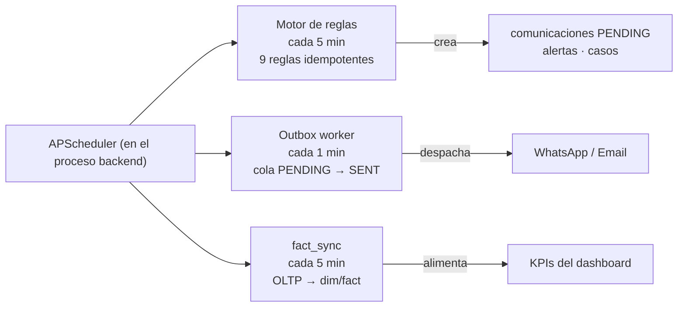

# 01 · Arquitectura del sistema

> **Polux Import — Fase Customers**: agente de Atención y Seguimiento para
> clientes que compran por importación. Documento técnico (equipo de
> desarrollo); para el manual de uso final ver [`05-manual-usuario.md`](05-manual-usuario.md).

**Última actualización:** 2026-11-09

---

## Tabla de contenido

1. [Visión general](#1-visión-general)
2. [Stack tecnológico](#2-stack-tecnológico)
3. [Contenedores y entornos](#3-contenedores-y-entornos)
4. [Estructura del repositorio](#4-estructura-del-repositorio)
5. [Capa backend](#5-capa-backend)
6. [Capa frontend](#6-capa-frontend)
7. [Orquestación: scheduler, motor de reglas, outbox, ETL](#7-orquestación-scheduler-motor-de-reglas-outbox-etl)
8. [Seguridad y roles](#8-seguridad-y-roles)
9. [Modos de operación (simulado vs real)](#9-modos-de-operación-simulado-vs-real)
10. [Decisiones arquitectónicas](#10-decisiones-arquitectónicas)

---

## 1. Visión general

```mermaid
flowchart TB
    subgraph Cliente["Clientes"]
        WA["WhatsApp Business"]
        TG["Telegram (demo, futuro)"]
    end

    subgraph Frontend["Frontend React (SPA) — localhost:5173"]
        UI["15 páginas: Dashboard, Pedidos, Entregas,<br/>Comunicaciones, Alertas, Casos, Imprevistos, Admin"]
    end

    subgraph Backend["Backend FastAPI — localhost:8000"]
        API["API REST /api/v1<br/>(19 routers + Swagger)"]
        RULES["Motor de reglas<br/>(9 reglas deterministas)"]
        AGENT["Agente IA<br/>(LLM acotado: clasifica y redacta)"]
        OUTBOX["Outbox<br/>(cola de salida transaccional)"]
        SCHED["APScheduler<br/>(5 min reglas · 1 min outbox · 5 min ETL)"]
        ETL["ETL dimensional<br/>(fact_sync → KPIs)"]
    end

    subgraph LLM["Proveedores externos (opcional)"]
        GEMINI["Gemini vía API compatible OpenAI"]
        MOCK["Mock local (fallback)"]
    end

    subgraph BD[["SQL Server 2022 — localhost:1433<br/>PoluxImportDB (31 tablas)"]]
        OLTP["Tablas operacionales"]
        DIM["Esquema dimensional<br/>dim_* + fact_*"]
    end

    WA -->|webhook| API
    TG -.->|posterior| API
    UI -->|fetch + JWT| API
    API --> OLTP
    RULES --> OLTP
    SCHED --> RULES
    SCHED --> OUTBOX
    SCHED --> ETL
    OUTBOX --> WA
    AGENT --> GEMINI
    AGENT -.-> MOCK
    ETL --> DIM
    API --> DIM
```

**Idea central:** el sistema percibe eventos (hitos, mensajes, retrasos),
razona con **reglas deterministas** apoyadas por un **LLM acotado** (solo
clasifica y redacta, nunca decide) y actúa por un **outbox transaccional**
que envía por los canales. Todo queda auditado en la base de datos.

---

## 2. Stack tecnológico

| Capa | Tecnología | Por qué |
|---|---|---|
| Base de datos | **SQL Server 2022** (contenedor Linux) | Requisito del cliente; CHECK constraints refuerzan reglas de negocio en BD |
| Backend | **Python 3.11 + FastAPI** | Async nativo, validación Pydantic, Swagger automático |
| ORM / migraciones | **SQLAlchemy 2 + Alembic** | Migraciones versionadas `0001`→`0005` |
| Frontend | **React 18 + Vite + TypeScript** | SPA ligera; tipado reducirá errores |
| Scheduler | **APScheduler** | Tareas periódicas dentro del propio proceso (sin infra extra) |
| LLM | **Gemini** vía endpoint compatible OpenAI (`generativelanguage.googleapis.com/v1beta/openai`) | El código ya es compatible OpenAI → activar solo con `.env` |
| Contenedores | **Docker Compose** | Entorno local reproducible con 3 servicios |

---

## 3. Contenedores y entornos

`docker-compose.yml` define exactamente **3 servicios**:

| Servicio | Imagen | Puerto | Notas |
|---|---|---|---|
| `db` | `mcr.microsoft.com/mssql/server:2022-latest` | 1433 | `SA_PASSWORD`, volumen de datos; healthcheck `sqlcmd` |
| `backend` | Python 3.11 + FastAPI | 8000 | `uvicorn --reload`; corre migraciones al arrancar |
| `frontend` | Node + Vite | 5173 | Desarrollo con hot-reload |

```bash
docker compose up -d --build          # levantar todo
docker compose exec -T backend alembic upgrade head   # migraciones
docker compose exec -T backend python -m scripts.seed_data  # catálogos
```

El backend arranca con **migraciones automáticas** (alembic upgrade en
entrypoint). Detalle completo de levantamiento: [`../LEVANTAMIENTO.md`](../LEVANTAMIENTO.md).

---

## 4. Estructura del repositorio

```
polux-import-customers/
├── docker-compose.yml          # 3 servicios: db, backend, frontend
├── .env                        # configuración local (desde .env.example)
├── README.md
├── LEVANTAMIENTO.md            # guía de levantamiento local
├── docs/                       # ← esta documentación (Mermaid versionable)
│   ├── PLAN_FASES.md           # roadmap y estado
│   ├── 01-arquitectura.md      # este documento
│   ├── 02-flujos.md
│   ├── 03-modelo-er.md
│   ├── 04-agente.md
│   ├── 05-manual-usuario.md
│   └── 06-api.md
├── backend/
│   ├── alembic/versions/       # 0001 … 0005 (migraciones SQL Server)
│   ├── app/
│   │   ├── api/v1/             # 19 routers (ver §5)
│   │   ├── core/               # config, logging, seguridad (JWT)
│   │   ├── db/                 # sesión, Base
│   │   ├── models/             # SQLAlchemy: orders, delivery, comms, analytics, core
│   │   ├── schemas/            # esquemas Pydantic (entrada/salida)
│   │   └── services/           # lógica de negocio (16 servicios)
│   ├── scripts/                # seed_data, test_data, demo_dashboard_data, demo_conversations
│   └── tests/                  # suite pytest
└── frontend/
    └── src/
        ├── pages/              # 15 páginas (ver §6)
        ├── components/         # DataTable, FilterBar, KpiChart, Modal…
        ├── auth/               # AuthContext, RequireAuth, RequireRole
        └── api/                # clientes fetch por recurso
```

---

## 5. Capa backend

### Routers (`/api/v1`)

| Router | Prefijo | Función |
|---|---|---|
| `health` | `/health` | Liveness + `/health/db` |
| `auth` | `/auth` | Login JWT, refresh, `/me` |
| `usuarios` | `/usuarios` | Usuarios y roles (ADMIN) |
| `pedidos` | `/pedidos` | CRUD y estados de pedidos |
| `items` | `/items` | Ítems del pedido (incluye `PATCH /{id}/estado`) |
| `hitos` | `/hitos` | Hitos por ítem, marcar completado, atrasos |
| `entregas` | `/entregas` | Crear/completar entrega (completa o parcial) |
| `casos` | `/casos` | Casos de escalamiento (1ª acción, cierre) |
| `imprevistos` | `/imprevistos` | Registro y resolución de imprevistos |
| `comunicaciones` | `/comunicaciones` | Historial y envío manual |
| `alertas` | `/alertas` | Bandeja de alertas (atender) |
| `reglas` | `/reglas` | Parámetros de reglas de negocio (`regla_negocio`) |
| `catalogos` | `/catalogos` | Catálogos (hitos, SLAs, umbrales KPI `dim_kpi`, plantillas) |
| `kpis` | `/kpis` | Cálculo KPI, series temporales, validación SQL |
| `dashboard` | `/dashboard` | `/resumen` (7 KPIs + semáforos) |
| `admin` | `/admin` | `POST /run-rules`, `/sync-facts` (operación manual) |
| `agent` | `/agent` | Agente IA: mensaje entrante, proveedor LLM, métricas, bandeja/hilo del simulador y respuesta humana (`/simulador`) |
| `outbox` | `/outbox` | Estado de cola y `POST /run` (despacho manual) |
| `webhooks` | `/webhooks` | Callback de WhatsApp (verificación + mensajes) |

Swagger interactivo: `http://localhost:8000/api/v1/docs`.

### Servicios de negocio (`app/services/`)

`pedido_service`, `hito_service`, `entrega_service`, `caso_service`,
`imprevisto_service`, `comunicacion_service`, `alerta_service`,
**`rule_engine`** (9 reglas), **`agent_service`** (flujos del agente),
**`llm_provider`** (mock/OpenAI-compatible), `notification_service`,
`template_renderer`, `whatsapp_service`, `email_service`,
**`outbox_worker`**, **`fact_sync_service`**, **`scheduler`**.

Los servicios validan las reglas de negocio (p. ej. una entrega parcial
exige autorización humana registrada: quién, cuándo, por qué — validado
también por un `CHECK` en la BD).

---

## 6. Capa frontend

15 páginas agradas por dominio:

| Grupo | Páginas |
|---|---|
| Acceso | `LoginPage`, `NotFoundPage` |
| Operación | `DashboardPage` (7 KPIs + filtros), `pedidos/PedidosListPage`, `pedidos/PedidoDetailPage` |
| Entregas | `entregas/EntregasPage`, `entregas/NuevaEntregaPage` |
| Comunicación | `comunicaciones/ComunicacionesPage`, `AlertasPage` |
| Casos | `casos/CasosPage`, `casos/ImprevistosPage` |
| Administración | `admin/UsuariosPage`, `admin/ReglasPage`, `admin/CatalogosPage`, `admin/AdminOpsPage` |

Componentes compartidos: `DataTable`, `Pagination`, `FilterBar`, `KpiChart`,
`StatusBadge`, `Modal`, `FormField`, `Layout`.
Autenticación: `AuthContext` + guards `RequireAuth` / `RequireRole`.

---

## 7. Orquestación: scheduler, motor de reglas, outbox, ETL



| Job | Intervalo | Función |
|---|---|---|
| `run_rule_engine_once` | `SCHEDULER_INTERVAL_SECONDS` = 300 s | Evalúa las 9 reglas; crea comunicaciones en cola, alertas y casos |
| `run_outbox_once` | `OUTBOX_INTERVAL_SECONDS` = 60 s | Despacha comunicaciones `PENDING` con reintentos y backoff exponencial |
| `run_fact_sync_once` | 300 s | Sincroniza hechos al esquema dimensional (`fact_*`) para los KPIs |

También se pueden disparar a mano (ADMIN):
`POST /admin/run-rules`, `POST /admin/sync-facts`, `POST /outbox/run`.

**Patrón outbox transaccional:** las comunicaciones se crean en la misma
transacción del evento (`estado_entrega=PENDING`); un worker aparte las
despacha. Si el envío falla, el estado queda en la BD con reintentos —
nunca se pierde un mensaje por un corte entre sistema y canal.

---

## 8. Seguridad y roles

- **JWT** (access token) en `Authorization: Bearer`; login en `/auth/login`.
- Roles (`usuario_rol`): `ADMIN`, `OPERADOR`, `GERENTE`.
- Dependencias `require_admin` / `require_operador` por endpoint:
  administración y catálogos solo ADMIN; operación (pedidos, entregas,
  casos) OPERADOR+; GERENTE solo lectura de tableros.
- Frontend: `RequireRole` oculta rutas; el backend vuelve a validar
  (nunca se confía solo en la UI).
- Webhook de WhatsApp: verificación de firma (`WHATSAPP_APP_SECRET`) y
  token de verificación.
- Contraseñas con hash (bcrypt via `security.hash_password`).

---

## 9. Modos de operación (simulado vs real)

Todo integrador externo tiene **modo simulado por defecto** para que el
sistema funcione completo sin credenciales:

| Integración | Variable clave | Modo local (`.env`) | Modo productivo |
|---|---|---|---|
| LLM | `LLM_PROVIDER` / `LLM_MODEL` | **Gemini activo** (`openai` + endpoint compatible OpenAI de Gemini); si la cuota o la red fallan, motor local (mock) automático | igual; para volver a simulado: `LLM_PROVIDER=mock` |
| WhatsApp | `WHATSAPP_DRY_RUN=true` | wamid sintético `dryrun.<uuid>` | `WHATSAPP_ENABLED=true` + token Meta |
| Email | `EMAIL_PROVIDER=mock` | Log en consola | `resend` o `smtp` |
| Scheduler | `SCHEDULER_ENABLED=true` | Corre siempre en local | igual (sin cambios) |

El cambio a productivo es **solo de `.env`** — el código no cambia.

> **Cortesía con la cuota del LLM.** Los planes gratuitos limitan ~5
> llamadas/minuto (RPM) y ~20/día (RPD). El provider usa una ventana
> deslizante (`LLM_RPM`), entra en reposo automático tras un 429
> (`LLM_COOLDOWN_SECONDS`) y ante cualquier fallo responde el **motor
> local (mock)**: la atención al cliente nunca se corta ni se quema cuota.
> Detalle en [`04-agente.md`](04-agente.md#5-el-llm-acotado-qué-hace-y-qué-no).

---

## 10. Decisiones arquitectónicas

| Decisión | Justificación |
|---|---|
| **Motor de reglas interno** (no n8n) | La orquestación ya existe, es idempotente y todo queda auditado en la BD. n8n duplicaría el estado y añadiría infraestructura. Reconsiderar solo si se pide edición visual de flujos o integración externa (CRM, Sheets). Detalle en [`04-agente.md`](04-agente.md#6-por-qu-no-se-usa-n8n) |
| **LLM acotado** | La IA clasifica y redacta; las decisiones (escalar, cerrar, entregar) son de reglas deterministas o humanas. Ver [`04-agente.md`](04-agente.md) |
| **Esquema dimensional separado** (`dim_*`/`fact_*`) | Los KPIs son consultas SQL estables sobre hechos ya agregados; el dashboard nunca compite con la carga operacional |
| **Reglas de negocio en BD** (`regla_negocio`, `dim_kpi`) | Umbrales y parámetros editables sin redeploy (parcial: umbrales KPI aún hardcodeados → Fase B del plan) |
| **Mermaid en `docs/`** | Los diagramas se versionan con el código y no requieren herramientas externas |

---

**Siguiente documento:** [`02-flujos.md`](02-flujos.md) (flujos del negocio)
· [`03-modelo-er.md`](03-modelo-er.md) (modelo entidad-relación)
