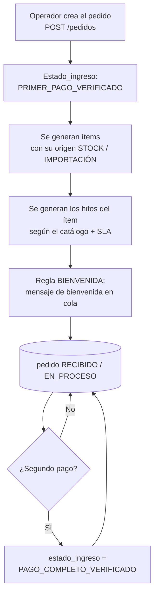
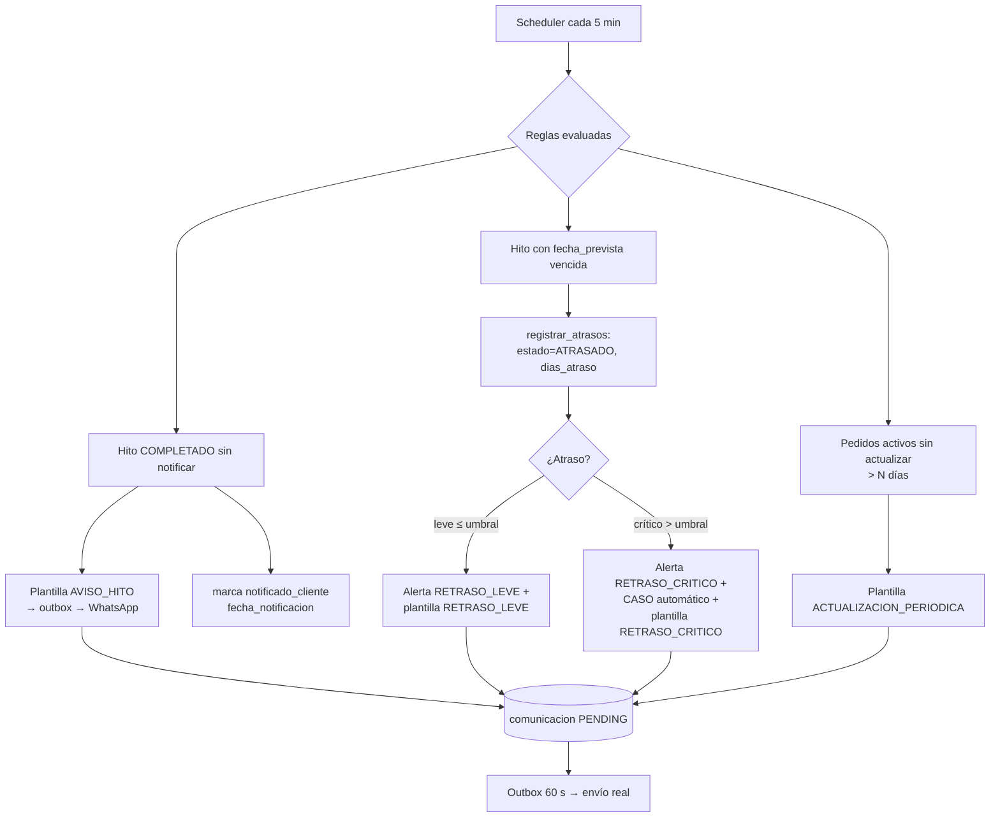
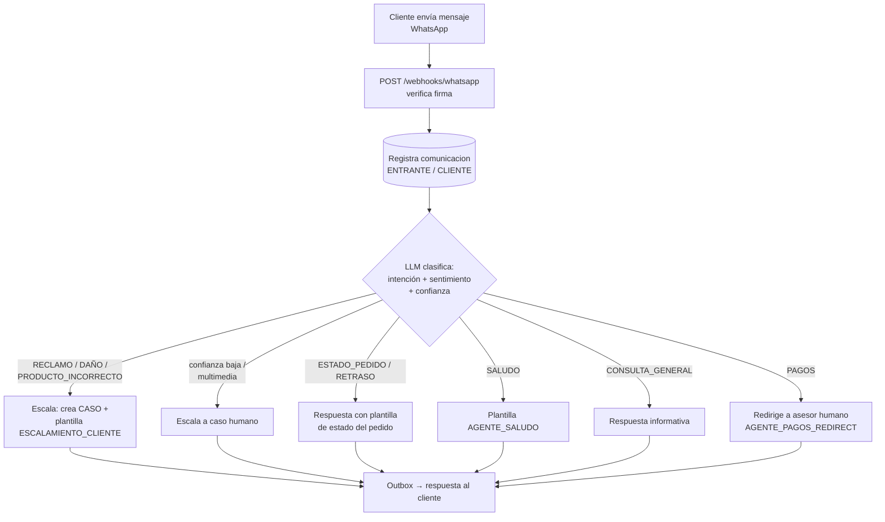
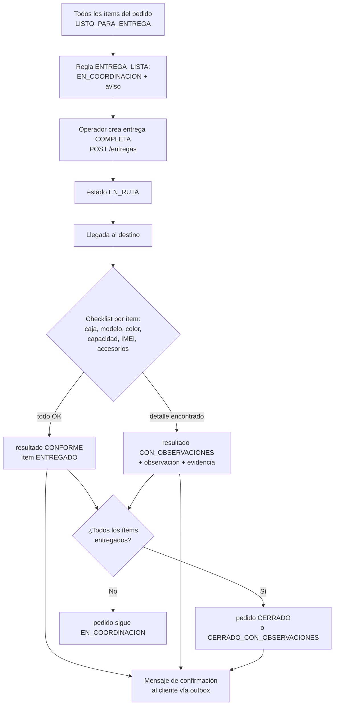
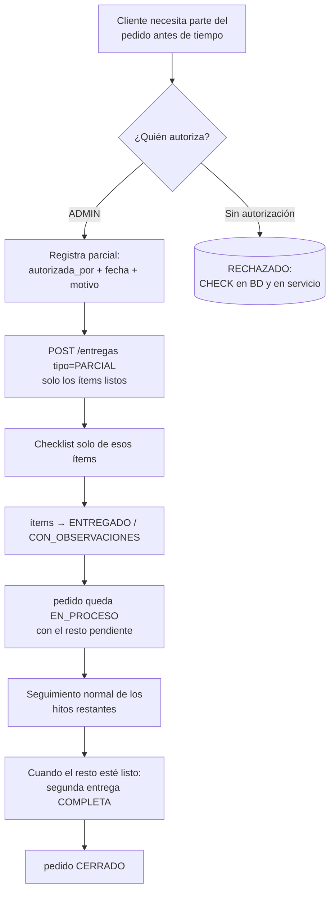

# 02 · Flujos del negocio

> Los 8 flujos principales del sistema, diagramados con Mermaid.
> Audiencia: equipo de desarrollo y analistas.

**Última actualización:** 2026-11-09

---

## Tabla de contenido

1. [Registro de pedido e ingreso de pago](#1-registro-de-pedido-e-ingreso-de-pago)
2. [Seguimiento de hitos y avisos al cliente](#2-seguimiento-de-hitos-y-avisos-al-cliente)
3. [Mensaje entrante del cliente (agente)](#3-mensaje-entrante-del-cliente-agente)
4. [Entrega completa con conformidad](#4-entrega-completa-con-conformidad)
5. [Entrega parcial autorizada](#5-entrega-parcial-autorizada)
6. [Escalamiento de caso](#6-escalamiento-de-caso)
7. [Imprevisto (incidencia)](#7-imprevisto-incidencia)
8. [Comunicación saliente y actualización de KPIs](#8-comunicación-saliente-y-actualización-de-kpis)

---

## 1. Registro de pedido e ingreso de pago



**Notas:**
- Los hitos se crean automáticamente al crear el ítem
  (`item_hito` con `fecha_prevista` encadenada por SLA).
- `fecha_prometida` del pedido = mayor `fecha_prevista` de sus hitos.

---

## 2. Seguimiento de hitos y avisos al cliente



**Regla de negocio clave:** un hito solo pasa a `COMPLETADO` con fecha
real; la notificación oportuna (≤2 h) alimenta el KPI
`FREQ_ACTUALIZACION_CLIENTE`.

---

## 3. Mensaje entrante del cliente (agente)



**Punto de no retorno:** cualquier mensaje de reclamo, daño o producto
incorrecto **nunca** se resuelve solo — siempre termina en un caso con
un humano responsable.

---

## 4. Entrega completa con conformidad



---

## 5. Entrega parcial autorizada



**Regla inviolable:** una entrega parcial exige **quién** la autorizó,
**cuándo** y **por qué** — validado dos veces (servicio + `CHECK` en BD).

---

## 6. Escalamiento de caso

```mermaid
flowchart TD
    A{Disparador} -->|Reclamo o tono negativo| B[caso RECLAMO]
    A -->|Atraso crítico| C[caso RETRASO_CRITICO<br/>creado por regla]
    A -->|Imprevisto abierto| D[caso IMPREVISTO]
    A -->|Falta de respuesta| E[caso FALTA_RESPUESTA]
    B & C & D & E --> F[(caso ABIERTO<br/>fecha_apertura)]
    F --> G[Humano atiende:<br/>POST /casos/{id} con<br/>fecha_primera_accion]
    G --> H[estado EN_PROCESO<br/>responsable asignado]
    H --> I{¿Resuelto?}
    I -->|Sí| J[estado RESUELTO<br/>fecha_cierre + descripción]
    I -->|No| K[Sigue en cola<br/>KPI: tiempo de respuesta]
    J --> L[Caso cerrado<br/>→ alimenta fact_escalamiento]
```

**KPI asociado:** `TIEMPO_RESPUESTA_ESCALADOS` = horas promedio entre
`fecha_apertura` y `fecha_primera_accion` (solo casos con acción).

---

## 7. Imprevisto (incidencia)

```mermaid
flowchart TD
    A[Se detecta la incidencia<br/>aduanera / operativa / proveedor] --> B[POST /imprevistos<br/>fecha_deteccion + tipo + descripción]
    B --> C[(imprevisto ABIERTO)]
    C --> D[Regla imprevisto:<br/>Alerta IMPREVISTO +<br/>CASO automático]
    D --> E[Responsable investiga<br/>estado EN_PROCESO]
    E --> F{¿Resuelto?}
    F -->|Sí| G[fecha_resolucion + resolución<br/>obligatorias → RESUELTO]
    F -->|No| E
    G --> H[Alerta atendida<br/>caso cerrado]
    H --> I[fact_sync →<br/>KPI TIEMPO_RESOLUCION_IMPREVISTOS<br/>(días promedio por tipo)]
```

---

## 8. Comunicación saliente y actualización de KPIs

```mermaid
flowchart TD
    subgraph Origen
        A[Regla / Agente / Operador]
    end
    A -->|misma transacción| B[(comunicacion<br/>estado_entrega = PENDING)]
    B --> C{Outbox cada 60 s}
    C -->|canal WHATSAPP| D[WhatsApp Cloud API<br/>o dry-run local]
    C -->|canal EMAIL| E[Email o mock]
    D & E --> F{¿Éxito?}
    F -->|Sí| G[SENT + wamid + enviado_en]
    F -->|No| H[intentos + 1<br/>proximo_intento = backoff]
    H -->|reintentos &lt; máximo| C
    H -->|reintentos agotados| I[FAILED +<br/>fallback email si está activo]
    G & I --> J[(auditoría completa en BD)]
    J --> K[fact_sync cada 5 min:<br/>fact_* ← tablas operacionales]
    K --> L[KPIs y series<br/>GET /dashboard/resumen<br/>GET /kpis/{codigo}/serie]
    L --> M[Dashboard con semáforos<br/>y filtros producto/origen/operador]
```

**Dos invariantes de este flujo:**
1. **Nada se envía sin haberse registrado primero** (outbox transaccional).
2. **Los KPIs solo leen `fact_*`** — nunca las tablas en caliente
   (estabilidad de las consultas del dashboard).

---

**Anterior:** [`04-agente.md`](04-agente.md) ·
**Siguiente:** [`05-manual-usuario.md`](05-manual-usuario.md)
