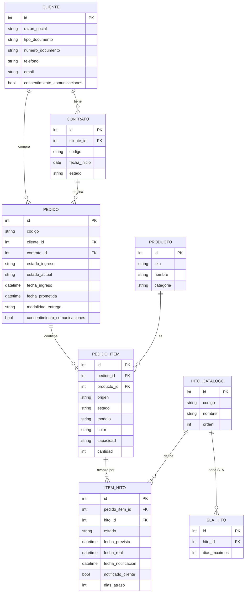
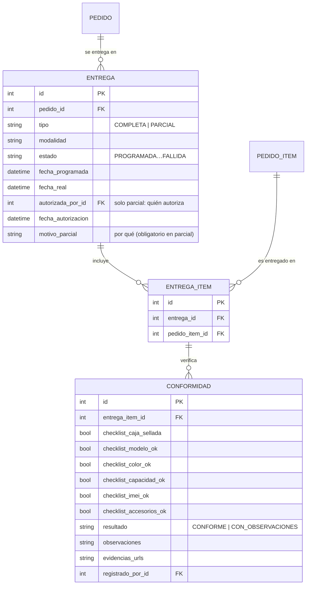
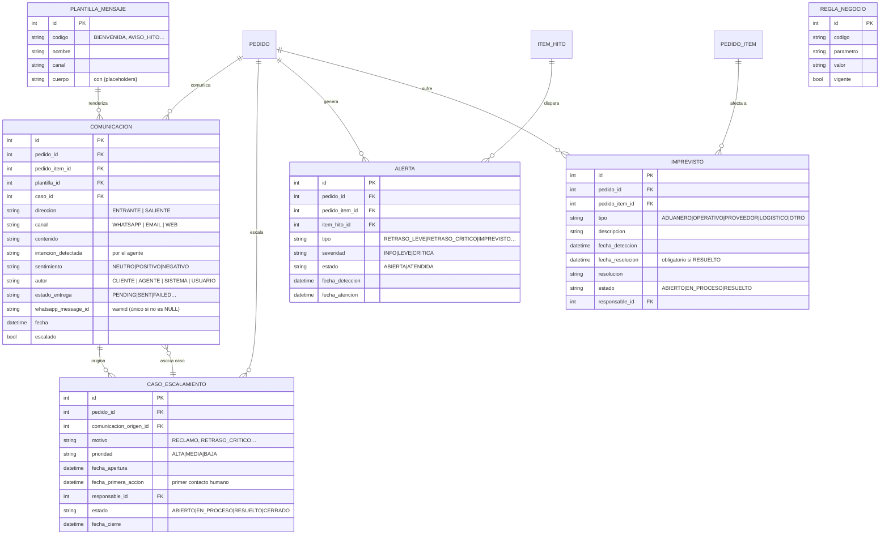
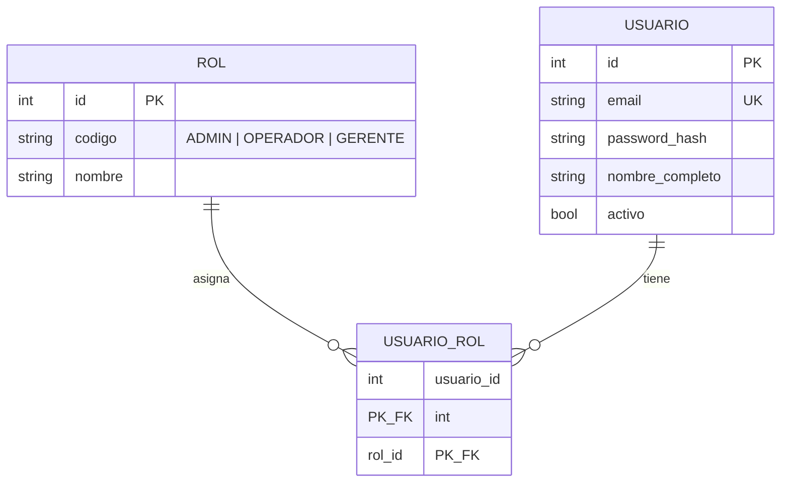
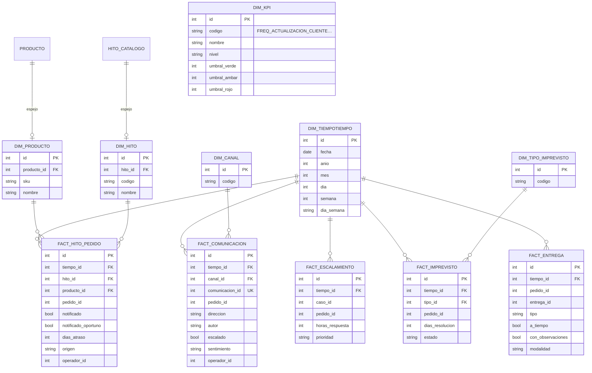

# 03 · Modelo entidad-relación

> 31 tablas en `PoluxImportDB`: 17 operacionales, 11 dimensionales
> (KPIs) y 3 de acceso/auditoría. Generado desde los modelos SQLAlchemy
> y verificado contra las FK reales de la BD.

**Última actualización:** 2026-11-09
**Fuente de verdad:** `backend/app/models/` (+ migraciones `0001`–`0005`)

---

## Tabla de contenido

1. [Convenciones](#1-convenciones)
2. [Esquema operacional](#2-esquema-operacional)
3. [Esquema de acceso y auditoría](#3-esquema-de-acceso-y-auditoría)
4. [Esquema dimensional (KPIs)](#4-esquema-dimensional-kpis)
5. [Catálogo de estados por tabla](#5-catálogo-de-estados-por-tabla)
6. [Reglas de integridad destacadas](#6-reglas-de-integridad-destacadas)

---

## 1. Convenciones

- **PK** `id INT IDENTITY` en todas las tablas.
- **Auditoría:** casi todas las tablas llevan `created_at`, `updated_at`,
  `created_by_id`, `updated_by_id` → `usuario` (no dibujados en los
  diagramas por claridad, pero existen).
- **Enums:** en BD son `NVARCHAR` con `CHECK`; en Python son `enum.Enum`
  (ver catálogo de estados en §5).
- **Borrado:** sin `ON DELETE CASCADE` entre pedidos y sus dependientes
  directos (restricción de SQL Server: una tabla no puede cascadear dos
  veces en la misma cadena) — el borrado se hace en orden desde el
  servicio o queda en `NO ACTION`.

---

## 2. Esquema operacional

Ciclo de vida: **cliente → contrato → pedido → ítems → hitos → entrega**,
con **comunicaciones, alertas, imprevistos y casos** acompañando al pedido.

### Entregas y conformidad

> **Regla inviolable:** una entrega `PARCIAL` exige `autorizada_por_id`,
> `fecha_autorizacion` y `motivo_parcial` (validado en servicio **y** por
> `CHECK ck_entrega_parcial_requiere_autorizacion` en BD).

### Comunicación, alertas, imprevistos y casos

> **Nota sobre el vínculo caso↔comunicación:** es bidireccional a
> propósito. `comunicacion.origen → caso` registra *qué mensaje originó el
> caso*; `caso → comunicacion.caso_id` marca *qué caso gestiona una
> comunicación* (así el motor de reglas evita duplicados).

---

## 3. Esquema de acceso y auditoría

---

## 4. Esquema dimensional (KPIs)

Separado del operacional: los KPIs leen **solo** `fact_*` (hechos ya
sincronizados por `fact_sync` cada 5 min), nunca transaccionales.

`dim_kpi` guarda los **umbrales de semáforo** de los 7 KPIs del
dashboard (verde/ámbar/rojo).

---

## 5. Catálogo de estados por tabla

| Tabla | Campo | Valores |
|---|---|---|
| `pedido` | `estado_actual` | `RECIBIDO` → `EN_PROCESO` → `LISTO_PARA_ENTREGA` → `EN_COORDINACION` → `ENTREGADO` → `CERRADO` / `CERRADO_CON_OBSERVACIONES` / `CANCELADO` |
| `pedido` | `estado_ingreso` | `PRIMER_PAGO_VERIFICADO`, `PAGO_COMPLETO_VERIFICADO` |
| `pedido_item` | `estado` | `PENDIENTE`, `EN_PROCESO`, `LISTO_PARA_ENTREGA`, `ENTREGADO`, `CON_OBSERVACIONES` |
| `item_hito` | `estado` | `PENDIENTE`, `EN_PROCESO`, `COMPLETADO`, `ATRASADO` |
| `entrega` | `tipo` | `COMPLETA`, `PARCIAL` |
| `entrega` | `estado` | `PROGRAMADA`, `EN_RUTA`, `ENTREGADA`, `FALLIDA`, `REPROGRAMADA` |
| `conformidad` | `resultado` | `CONFORME`, `CON_OBSERVACIONES` |
| `comunicacion` | `direccion` | `ENTRANTE`, `SALIENTE` |
| `comunicacion` | `canal` | `WHATSAPP`, `EMAIL`, `WEB` |
| `comunicacion` | `autor` | `CLIENTE`, `AGENTE`, `SISTEMA`, `USUARIO` |
| `comunicacion` | `estado_entrega` | `PENDING`, `SENT`, `SENT_EMAIL`, `FAILED_RETRY`, `FAILED` (NULL = entrante) |
| `caso_escalamiento` | `estado` | `ABIERTO`, `EN_PROCESO`, `RESUELTO`, `CERRADO` |
| `caso_escalamiento` | `motivo` | `RECLAMO`, `RETRASO_LEVE`, `RETRASO_CRITICO`, `IMPREVISTO`, `DAÑO`, `PRODUCTO_INCORRECTO`, `FALTA_RESPUESTA` |
| `imprevisto` | `tipo` | `ADUANERO`, `OPERATIVO`, `PROVEEDOR`, `LOGISTICO`, `OTRO` |
| `imprevisto` | `estado` | `ABIERTO`, `EN_PROCESO`, `RESUELTO` (exige `fecha_resolucion`) |
| `alerta` | `tipo` | `RETRASO_LEVE`, `RETRASO_CRITICO`, `IMPREVISTO`, `SILENCIO_CLIENTE`, `ESCALAMIENTO` |
| `alerta` | `estado` | `ABIERTA`, `ATENDIDA` |
| `pedido` | `modalidad_entrega` | `DOMICILIO`, `RECOJO` |
| `pedido_item` | `origen` | `STOCK_TRUJILLO`, `IMPORTACION` |

---

## 6. Reglas de integridad destacadas

1. **Entrega parcial autorizada** — `CHECK ck_entrega_parcial_requiere_autorizacion`:
   `tipo='PARCIAL'` ⇒ `autorizada_por_id`, `fecha_autorizacion` y
   `motivo_parcial` NO NULL.
2. **Imprevisto resuelto** — `fecha_resolucion` obligatoria en `RESUELTO`.
3. **wamid único filtrado** (migración `0005`) — índice único sobre
   `comunicacion.whatsapp_message_id` **solo cuando no es NULL**
   (SQL Server no admite varios NULL en UNIQUE; un `UNIQUE` simple
   rompía la cola de mensajes).
4. **Auditoría completa** — `created_by_id`/`updated_by_id` en casi todas
   las tablas operacionales.
5. **Sin cascadas dobles** — SQL Server rechaza cadenas de cascade
   (`pedido → pedido_item → X` cuando `X` también cascadea de `pedido`);
   por eso `caso_escalamiento.comunicacion_origen_id` y
   `comunicacion.caso_id` son `NO ACTION` (borrar requiere desvincular
   primero).

---

**Anterior:** [`01-arquitectura.md`](01-arquitectura.md) ·
**Siguiente:** [`04-agente.md`](04-agente.md)
