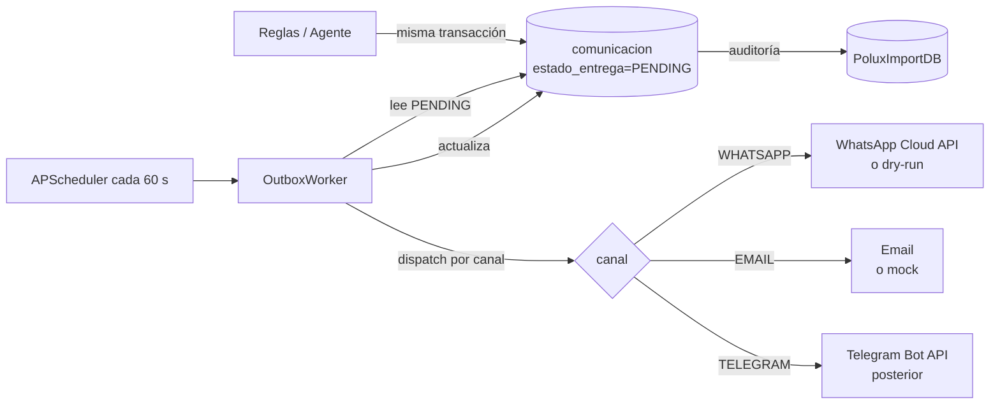
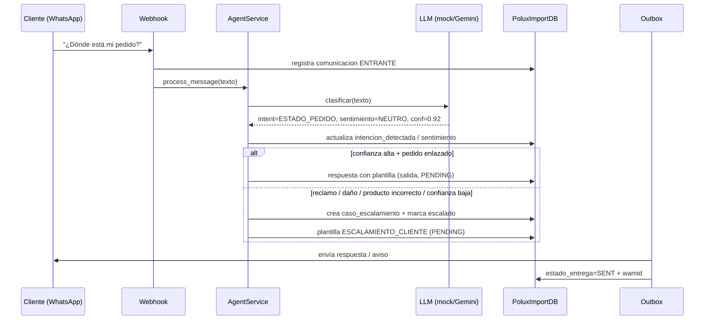
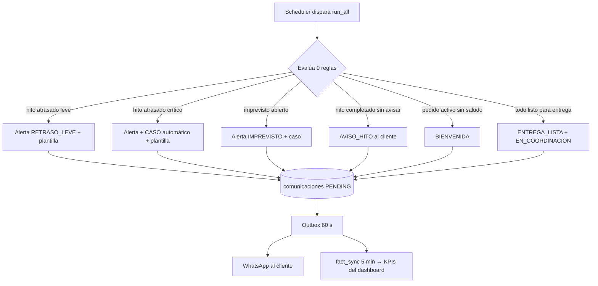
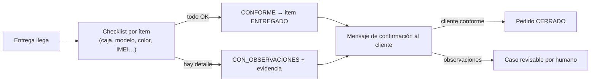
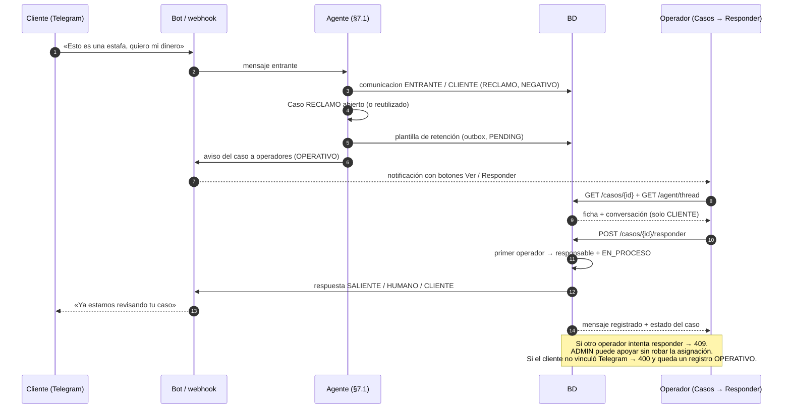
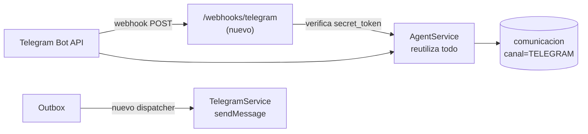

# 04 · Definición del agente de atención y seguimiento

> Qué es el agente, cómo razona, qué decide (y qué **no** decide),
> qué canales usa, el diseño del canal Telegram para la demo y por qué
> se descartó n8n.

**Última actualización:** 2026-11-09
**Código:** `backend/app/services/agent_service.py`, `rule_engine.py`,
`llm_provider.py` · **API:** `backend/app/api/v1/agent.py`

---

## Tabla de contenido

1. [Propósito](#1-propósito)
2. [Arquitectura de tres capas: percibir → razonar → actuar](#2-arquitectura-de-tres-capas-percibir--razonar--actuar)
3. [Capa de percepción](#3-capa-de-percepción)
4. [Capa de razonamiento: 9 reglas deterministas](#4-capa-de-razonamiento-9-reglas-deterministas)
5. [El LLM acotado: qué hace y qué no](#5-el-llm-acotado-qué-hace-y-qué-no)
6. [Capa de actuación: outbox y canales](#6-capa-de-actuación-outbox-y-canales)
7. [Flujos del agente](#7-flujos-del-agente)
8. [Decisiones reservadas a humanos](#8-decisiones-reservadas-a-humanos)
9. [Canal Telegram (demo) — diseño](#9-canal-telegram-demo--diseño)
10. [Por qué no se usa n8n](#10-por-qu-no-se-usa-n8n)
11. [Configuración (.env)](#11-configuración-env)
12. [Métricas y observabilidad](#12-métricas-y-observabilidad)

---

## 1. Propósito

**Agente IA de Atención y Seguimiento para la Fase Customers de Polux
Import.** Acompaña automáticamente al cliente durante la importación y
entrega de su pedido:

1. **Actualizaciones proactivas** en cada hito (bienvenida, avance de
   hitos, entrega lista, entrega completada).
2. **Registro de comunicaciones** (entrantes y salientes) con intención y
   sentimiento detectados.
3. **Alertas** ante incidencias y retrasos (leves y críticos).
4. **Escalación de casos** que requieren intervención humana.
5. **Verificación de conformidad** al entregar y **confirmación** del
   resultado (conforme / con observaciones).

Todo apoyado en **reglas de negocio simples** (parametrizables en BD) y
**una base de datos que audita cada evento**.

---

## 2. Arquitectura de tres capas: percibir → razonar → actuar

```
PERCEPCIÓN                              RAZONAMIENTO                             ACTUACIÓN
──────────                              ─────────────                             ─────────
Scheduler (cada 5 min)                ─┐
Mensajes entrantes (WhatsApp/Telegram) ─┼→  9 reglas deterministas   ────────────→  Outbox → Canal
Eventos de hitos / SLA / entregas     ─┤      (idempotentes, en BD)  ─┐
                                     └→  LLM acotado                ─┴→  clasifica y redacta
                                          (solo propone; NUNCA decide)      → escala a humano
```

- **Percepción:** el scheduler, el webhook del canal y los endpoints de la
  API introducen eventos.
- **Razonamiento:** reglas deterministas (fuente de verdad) + LLM que
  **clasifica** mensajes y **redacta** respuestas con plantillas.
- **Actuación:** todo sale por el **outbox** (cola transaccional) y queda
  registrado en `comunicacion` antes de enviarse.

---

## 3. Capa de percepción

| Fuente | Entrada | Quién la procesa |
|---|---|---|
| Scheduler (300 s) | Reloj: hitos atrasados, silencio del cliente, periodos | `rule_engine.run_all()` |
| Webhook WhatsApp | Mensaje entrante del cliente | `POST /webhooks/whatsapp` → `agent_service.process_message` |
| API (simulación) | Mensaje entrante de prueba | `POST /agent/mensaje` |
| Endpoints CRUD | Hitos completados, entregas, imprevistos | Al confirmar en la UI, el próximo ciclo de reglas reacciona |

---

## 4. Capa de razonamiento: 9 reglas deterministas

`rule_engine.py` — cada regla es **idempotente** (repetir no duplica
alertas, casos ni mensajes) y agrupa su ejecución en `run_all()`:

| # | Regla | Dispara cuando… | Acción |
|---|---|---|---|
| 1 | `bienvenida` | Pedido `PRIMER_PAGO_VERIFICADO` activo sin saludo | Plantilla `BIENVENIDA` (salida, en cola) |
| 2 | `aviso_hito` | Hito `COMPLETADO` sin `fecha_notificacion` | Plantilla `AVISO_HITO` + marca notificado |
| 3 | `actualizacion_periodica` | Pedidos en curso sin actualizar > N días | Plantilla `ACTUALIZACION_PERIODICA` |
| 4 | `retraso_leve` | Hito con atraso leve (≤ umbral) | Plantilla `RETRASO_LEVE` + alerta `RETRASO_LEVE` |
| 5 | `retraso_critico` | Hito atrasado > umbral crítico | Plantilla `RETRASO_CRITICO` + alerta + **caso automático** `RETRASO_CRITICO` |
| 6 | `imprevisto` | Imprevisto `ABIERTO/EN_PROCESO` sin caso | Alerta `IMPREVISTO` + caso `IMPREVISTO` |
| 7 | `silencio_cliente` | Cliente sin respuesta tras aviso (regla de contacto) | Alerta `SILENCIO_CLIENTE` + reintentos controlados |
| 8 | `reclamo_tono_negativo` | Mensaje entrante con intención `RECLAMO` o sentimiento `NEGATIVO` | Escala: `caso_escalamiento` + plantilla `ESCALAMIENTO_CLIENTE`; marca `comunicacion.escalado=true` |
| 9 | `entrega_lista` | Ítems todos `LISTO_PARA_ENTREGA` | Estado `EN_COORDINACION` + plantilla `ENTREGA_LISTA` |

Los umbrales viven en la tabla **`regla_negocio`** (editable desde
Admin → Reglas, sin redeploy).

---

## 5. El LLM acotado: qué hace y qué no

**Sí hace:**

- **Clasificar** mensajes entrantes en `Intent`
  (`SALUDO`, `ESTADO_PEDIDO`, `RETRASO`, `CONSULTA_GENERAL`,
  `ENTREGA_PARCIAL`, `RECLAMO`, `DAÑO`, `PRODUCTO_INCORRECTO`,
  `PAGOS`, `OTRO`) + `Sentimiento` (`NEUTRO/POSITIVO/NEGATIVO`) +
  confianza.
- **Redactar** el cuerpo de las respuestas usando **plantillas
  parametrizadas** (el modelo llena variables; no inventa estructura).
- **Extraer datos** del mensaje (número de pedido, producto) para
  enlazar la conversación al pedido correcto.

**No hace nunca (por diseño):**

| Prohibido | Por qué |
|---|---|
| Calcular KPIs o fechas | Los KPIs son **100 % SQL** sobre `fact_*`; las fechas salen de hitos/SLAs en BD |
| Cambiar estados de pedido/entrega | Transiciones solo por servicios con validación |
| Cerrar casos o resolver reclamos | Reservado a humanos (§8) |
| Autorizar entregas parciales | Exige usuario ADMIN registrado en BD |
| Escribir directamente a la BD | Solo lee contexto; las acciones pasan por servicios |

**Confianza baja = escala.** Si el LLM clasifica con poca confianza, el
mensaje se escala a caso humano en lugar de responder mal
(`test_baja_confianza_escala`).

**Proveedores** (`llm_provider.py`, interfaz OpenAI-compatible):

| `LLM_PROVIDER` | Comportamiento |
|---|---|
| `mock` (default) | Clasificación por palabras clave locales — el sistema funciona 100 % sin API key |
| `openai` | Cualquier endpoint compatible OpenAI; para Gemini: `LLM_BASE_URL=https://generativelanguage.googleapis.com/v1beta/openai` |

**Estado actual: Gemini activo** (`LLM_MODEL=gemini-3.1-flash-lite`, con
`LLM_MODEL_FALLBACK=gemini-3.5-flash` si el principal está en alta
demanda). El provider se identifica como `gemini` en la UI
(*Motor: gemini*) y en `GET /agent/provider`.

El cambio de proveedor es **solo `.env`** (§11).

**Frugalidad con la cuota (obligatoria en planes gratuitos: ~5 RPM / ~20 RPD):**

| Protección | Variable | Qué hace |
|---|---|---|
| Ventana deslizante de 60 s | `LLM_RPM=5` | Nunca se superan `LLM_RPM` llamadas por minuto (clasificar + redactar comparten el contador). Si se excede, responde el motor local **sin gastar la llamada** |
| Reposo tras 429 | `LLM_COOLDOWN_SECONDS=60` | Si llega un 429 (cuota RPM/RPD agotada) no se reintenta: reposo de 60 s y motor local |
| Reintentos acotados | `LLM_MAX_RETRIES=1` | 1 reintento ante 5xx/transitorios, con backoff corto, dentro del presupuesto `LLM_TIMEOUT_SECONDS` (20 s totales) |
| Modelo respaldo | `LLM_MODEL_FALLBACK` | Si el modelo principal devuelve 5xx, se prueba una vez el respaldo antes de caer al motor local |
| Motor local | (siempre) | Cualquier fallo → `MockProvider`: la conversación continúa y la UI marca `mock_fallback` |

Los tests corren **siempre** con `LLM_PROVIDER=mock` (lo fija
`tests/conftest.py`): la suite nunca consume cuota
(`test_llm_provider.py`).

---

## 6. Capa de actuación: outbox y canales



- **Nunca se envía directamente desde la regla:** primero se registra en
  BD (transacción atómica) y el worker despacha con reintentos y backoff
  (`WHATSAPP_MAX_RETRIES`, `WHATSAPP_BACKOFF_BASE_SECONDS`).
- Estados: `PENDING` → `SENT` / `FAILED_RETRY` → `FAILED` (con fallback
  a email si `EMAIL_ENABLED`).

---

## 7. Flujos del agente

### 7.1 Mensaje entrante del cliente (reacción)



### 7.2 Seguimiento proactivo (cada 5 minutos)



### 7.3 Verificación de conformidad y confirmación de entrega



### 7.4 Conversaciones y respuesta local a casos

El operador puede atender al cliente por **dos canales equivalentes**:

1. **Telegram**, respondiendo al aviso del caso o con los comandos del bot
   (`/casos`, botones *Ver caso* / *Responder*, `/liberar`).
2. **Plataforma web**, desde **Contestador** (solo conversaciones
   asignadas al operador) o **Casos → Responder** (asignados + libres para
   reclamar). Se ve el hilo, el responsable, si el cliente tiene Telegram
   vinculado y se escribe la respuesta sin usar el móvil del operador.

Ambos canales comparten el mismo servicio (`caso_service`), así que la
asignación, la línea de tiempo y la auditoría son idénticas. **No se crean
tablas nuevas**: el hilo sigue siendo `comunicacion` filtrada por
`pedido_id`, ahora con una columna `clase`:

- `CLIENTE`: conversación real (entrantes del cliente, respuestas del
  agente/plantillas y respuestas humanas).
- `OPERATIVO`: comandos del bot, ayudas, confirmaciones, avisos a
  operadores, reenvíos internos y respuestas bloqueadas (por ejemplo, un
  intento sin Telegram del cliente).

| Pantalla / acción | Endpoint | Qué hace |
|---|---|---|
| Bandeja de conversaciones | `GET /agent/chats` | Un chat por pedido con cliente, último mensaje `CLIENTE`, número de mensajes, caso abierto y responsable. ADMIN ve todo; OPERADOR solo sus casos asignados |
| Hilo | `GET /agent/thread?pedido_id=` | Mensajes ordenados con clasificación, plantilla, estado de entrega y caso. `incluir_operativos=true` añade los internos (auditoría). Un OPERADOR solo abre casos libres o propios |
| Ficha del caso | `GET /casos/{id}` | Pedido, cliente, responsable y si el usuario actual puede responder |
| Responder caso | `POST /casos/{id}/responder` | Envía la respuesta al cliente por Telegram y registra el mensaje como `HUMANO` / `CLIENTE`. ADMIN puede apoyar sin cambiar la asignación |
| Cerrar caso | `POST /casos/{id}/cerrar` | Cierra el caso y avisa al cliente si tiene Telegram |
| Asignar / liberar | `POST /casos/{id}/reasignar` | ADMIN asigna o reasigna; el OPERADOR responsable libera con `responsable_id=null`. Audita como `OPERATIVO` y avisa por Telegram |
| Compatibilidad | `POST /agent/human-reply` | Respuesta humana sin caso; solo ADMIN puede usarlo con pedidos sin caso |
| Prueba del agente | `POST /agent/messages/incoming` | Simula un mensaje entrante: clasifica → responde o escala |



**Reglas de visibilidad y asignación (OPERADOR+):**

- `ADMIN` ve todos los clientes, chats y casos; puede responder, asignar,
  reasignar, liberar y cerrar cualquier caso.
- `OPERADOR` ve en **Contestador** solo los chats de casos asignados a él.
  En **Casos** ve los asignados + los libres para poder reclamarlos.
- El **primer operador** que responde un caso libre queda como
  `responsable_id`; los demás reciben `409` para evitar duplicados.
- Un operador puede **liberar** su propio caso (`responsable_id=null`) para
  que otro lo tome. La liberación conserva historial, primera acción y
  estado, y queda auditada como `OPERATIVO`.
- `ADMIN` puede reasignar a cualquier `ADMIN`/`OPERADOR` activo. La
  reasignación se audita y se avisa por Telegram al nuevo responsable.
- La respuesta se registra con `autor=HUMANO`, `clase=CLIENTE`,
  `usuario_id`/`created_by` del usuario real y `estado_entrega` según el
  envío: **nadie puede firmar por otro** (§8).
- Se actualiza `fecha_primera_accion` y, si estaba `ABIERTO`, pasa a
  `EN_PROCESO`. La línea de tiempo muestra el evento y el hilo del caso.
- **Sin Telegram del cliente** (`cliente.telegram_chat_id` vacío): se
  devuelve `400 sin_telegram`, **no** se asigna el caso y el intento se
  guarda como `OPERATIVO` con `estado_entrega=FAILED`. El cliente debe
  enviar su código de pedido + DNI al bot para vincular el chat.
- La respuesta humana activa el mismo cortapisa de §7.1
  (`_human_in_progress`, `AGENT_RECENT_HUMAN_RESPONSE_MINUTES=10`):
  durante ese lapso el agente **no** responde y la UI lo indica.

**Cotas del LLM en la práctica:** cada mensaje de cliente puede costar
hasta 4 llamadas (clasificar + redactar, cada una con reintento al modelo
respaldo). El `RateGuard` de §5 limita eso a `LLM_RPM=5` por minuto; lo
que exceda la ventana responde el motor local, y un 429 dispara el reposo
de 60 s. Por eso la demo puede usarse sin agotar el plan gratuito.

---

## 8. Decisiones reservadas a humanos

| Decisión | Quién | Cómo queda registrado |
|---|---|---|
| Autorizar entrega **parcial** | ADMIN | `entrega.autorizada_por_id` + fecha + motivo (CHECK en BD) |
| Cerrar un pedido | Operador/Admin | `pedido.estado_actual = CERRADO` vía servicio |
| Resolver un reclamo / caso | Humano | `caso_escalamiento.fecha_primera_accion`, `responsable_id`, `fecha_cierre` |
| Resolver un imprevisto | Responsable | `imprevisto.resolucion` + `fecha_resolucion` |
| Atender una alerta | Operador | `alerta.estado = ATENDIDA` + `fecha_atencion` |

**Mensaje central:** el agente *observa, clasifica, redacta y escala*.
La IA jamás inventa fechas ni calcula indicadores — eso es una
**característica** (auditoría y previsibilidad), no una limitación.

---

## 9. Canal Telegram (demo) — diseño

> **Estado:** definido aquí; **implementación en una iteración posterior**
> (Fase C2 del plan). Telegram es el canal ideal para **demostrar** el
> agente en vivo: sin revisión de Meta, activación en minutos.

### 9.1 Por qué Telegram para la demo

| | WhatsApp (productivo) | Telegram (demo) |
|---|---|---|
| Requiere revisión/comercio de Meta | Sí (Business API + verificación) | No — Bot API abierta |
| Activación | Días | Minutos (`@BotFather`) |
| Costo | Por conversación 24 h | Gratis |
| Uso del cliente final | ✅ canal real de los clientes | Solo demo/interno |

### 9.2 Diseño propuesto (mismo patrón que WhatsApp)



**Cambios necesarios (lista de implementación):**

1. **Enum `Canal`**: añadir `TELEGRAM` (`models/comms.py` +
   `dim_canal`).
2. **`telegram_service.py`**: cliente Bot API (`getMe`, `sendMessage`,
   `setWebhook`) — espejo de `whatsapp_service.py`.
3. **Webhook `POST /webhooks/telegram`**: verificar header
   `X-Telegram-Bot-Api-Secret-Token`; mapear `chat_id` → mensaje
   entrante (texto; multimedia → escala, igual que WhatsApp).
4. **Dispatcher en `outbox_worker._process_one`**: `if canal ==
   TELEGRAM → telegram_service.send(...)`.
5. **Mapeo cliente ↔ chat_id**: tabla o columna
   `cliente.telegram_chat_id`; para la demo, **allowlist** de chat_ids
   de prueba (solo esos chats hablan con el bot).
6. **Comandos de demo** (opcionales): `/estado` → resumen del último
   pedido; `/pedido <codigo>` → hitos. Se resuelven como intents
   preclasificados (sin coste de LLM).
7. **`.env`**: `TELEGRAM_ENABLED`, `TELEGRAM_BOT_TOKEN`,
   `TELEGRAM_WEBHOOK_SECRET`.

**Ventaja estructural:** no hay que tocar reglas, agente, plantillas ni
outbox (salvo el dispatch) — todo el flujo de §7 se reutiliza tal cual,
porque el agente es agnóstico del canal.

---

## 10. Por qué no se usa n8n

**Decisión: descartado.** Se documenta para no reabrirlo sin argumentos:

| Criterio | Motor interno (elegido) | n8n (descartado) |
|---|---|---|
| Orquestación | Ya implementado: scheduler + 9 reglas idempotentes + outbox | Duplicaría los flujos existentes (dos fuentes de verdad en paralelo) |
| Auditoría | Todo el estado vive en `PoluxImportDB` (casos, alertas, comunicaciones) | El estado de los flujos quedaría **fuera de la BD de auditoría** (imposible cumplir §"cada evento queda auditado") |
| Consistencia transaccional | Mensaje creado y evento en la **misma transacción** (patrón outbox) | Dos sistemas, sin transacción compartida → mensajes perdidos o duplicados |
| Infraestructura | Cero: corre dentro del contenedor backend | +1 servicio que mantener, versionar y monitorear |
| Trazabilidad KPI | Hechos → `fact_*` directamente | Requeriría sincronizar también estados de n8n |

**Cuándo reconsiderarlo:** solo si se necesita (a) **edición visual de
flujos por usuarios no técnicos**, o (b) integración con herramientas
externas fuera del alcance actual (CRM, Google Sheets, email marketing,
otras APIs). En ese caso, n8n sería un **complemento** que consume la API
(`/api/v1`) — nunca un reemplazo del motor interno ni de la BD.

---

## 11. Configuración (`.env`)

```bash
# --- LLM (agente IA · Gemini vía endpoint compatible OpenAI) ---
LLM_PROVIDER=openai              # mock = motor local sin API key
LLM_API_KEY=                     # clave de aistudio.google.com (NUNCA se commitea)
LLM_BASE_URL=https://generativelanguage.googleapis.com/v1beta/openai   # Gemini (compatible OpenAI)
LLM_MODEL=gemini-3.1-flash-lite
LLM_MODEL_FALLBACK=gemini-3.5-flash   # se intenta si el principal da 5xx
LLM_TIMEOUT_SECONDS=20           # presupuesto TOTAL por mensaje (reintentos incluidos)
LLM_MAX_TOKENS=400
LLM_MAX_RETRIES=1                # reintentos ante 5xx (NUNCA ante 429)
LLM_RPM=5                        # máx. llamadas/min (ventana deslizante)
LLM_COOLDOWN_SECONDS=60          # reposo tras 429 → responde el motor local

# --- WhatsApp (canal productivo) ---
WHATSAPP_ENABLED=false
WHATSAPP_DRY_RUN=true            # true = no envía de verdad, wamid sintético
WHATSAPP_TOKEN=
WHATSAPP_PHONE_NUMBER_ID=
WHATSAPP_VERIFY_TOKEN=polux-verify-token
WHATSAPP_APP_SECRET=

# --- Email (fallback) ---
EMAIL_ENABLED=false
EMAIL_PROVIDER=mock              # mock | resend | smtp

# --- Orquestación ---
SCHEDULER_ENABLED=true
SCHEDULER_INTERVAL_SECONDS=300   # motor de reglas
OUTBOX_INTERVAL_SECONDS=60       # despacho de la cola
```

---

## 12. Métricas y observabilidad

| Qué | Dónde |
|---|---|
| Métricas del agente (mensajes, escalados, confianza) | `GET /agent/metrics` |
| Proveedor LLM activo | `GET /agent/provider` |
| Clasificar sin ejecutar el flujo (ADMIN) | `POST /agent/clasificar` |
| Logs estructurados | `rule_engine`, `outbox`, `scheduler` (`docker compose logs backend`) |
| KPIs de negocio | Dashboard (`GET /dashboard/resumen`) |
| Validación de cada KPI (SQL de contraste) | `GET /kpis/validacion` |

---

**Anterior:** [`03-modelo-er.md`](03-modelo-er.md) ·
**Siguiente:** [`05-manual-usuario.md`](05-manual-usuario.md)
