# 05 · Manual de usuario

> **Para quién es:** para las personas que usarán el sistema a diario —
> no necesitas saber de programación. Cada tarea está explicada paso a
> paso, con capturas de pantalla reales del sistema.

**Última actualización:** 2026-11-10

---

## Tabla de contenido

1. [Primeros pasos](#1-primeros-pasos)
2. [Ver el panel general](#2-ver-el-panel-general)
3. [Buscar y revisar un pedido](#3-buscar-y-revisar-un-pedido)
4. [Marcar un hito como completado](#4-marcar-un-hito-como-completado)
5. [Revisar las alertas](#5-revisar-las-alertas)
6. [Atender un caso de escalamiento](#6-atender-un-caso-de-escalamiento)
7. [Registrar y resolver un imprevisto](#7-registrar-y-resolver-un-imprevisto)
8. [Revisar las conversaciones con clientes](#8-revisar-las-conversaciones-con-clientes)
9. [Programar y completar una entrega](#9-programar-y-completar-una-entrega)
10. [Administración (solo Admin)](#10-administración-solo-admin)
11. [Qué puede ver cada rol](#11-puede-ver-cada-rol)
12. [Hablar con el agente IA](#12-hablar-con-el-agente-ia)
13. [Responder casos desde la plataforma](#13-responder-casos-desde-la-plataforma)
14. [Preguntas frecuentes](#14-preguntas-frecuentes)

---

## 1. Primeros pasos

### 1.1 Iniciar sesión

1. Abre el navegador en la dirección del sistema
   (la que te indicó el equipo de soporte; en local es
   `http://localhost:5173`).
2. Verás la pantalla de acceso:

   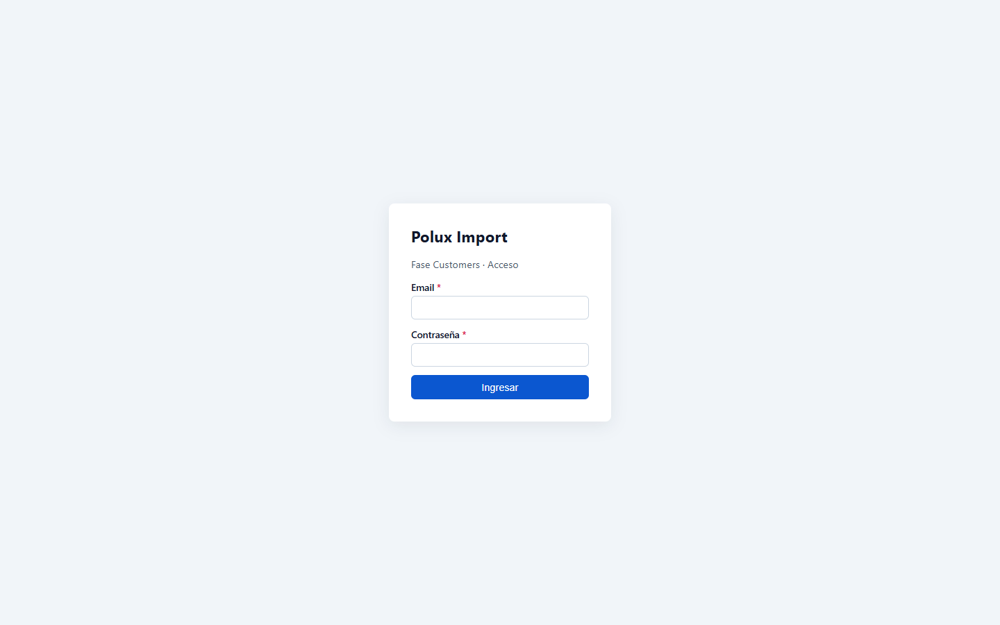

3. Escribe tu **correo** y tu **contraseña**.
4. Haz clic en **Ingresar**.

Si los datos son correctos, entrarás al panel. Si no, aparecerá el
mensaje *"Credenciales inválidas o servicio no disponible"* — revisa que
el correo y la contraseña estén bien escritos.

### 1.2 Tu menú

A la izquierda verás el menú. Las opciones dependen de tu rol:

| Menú | Para qué sirve |
|---|---|
| **Dashboard** | Panel general con los indicadores |
| **Pedidos** | Ver el avance de cada pedido |
| **Alertas** | Avisos que requieren atención |
| **Casos** | Reclamos y situaciones que atiende una persona |
| **Imprevistos** | Problemas de aduana, logística, etc. |
| **Entregas** | Programar y registrar entregas |
| **Comunicaciones** | Todo lo que se ha hablado con los clientes |
| **Agente IA** | Probar cómo responde el asistente automático |
| **Usuarios / Reglas / Catálogos / Operaciones** | Solo para Administradores |

Arriba a la derecha verás tu **rol** (por ejemplo `Rol: ADMIN`) y el
botón **Salir** para cerrar la sesión.

---

## 2. Ver el panel general

**¿Para qué?** En una sola pantalla saber cómo va el negocio.

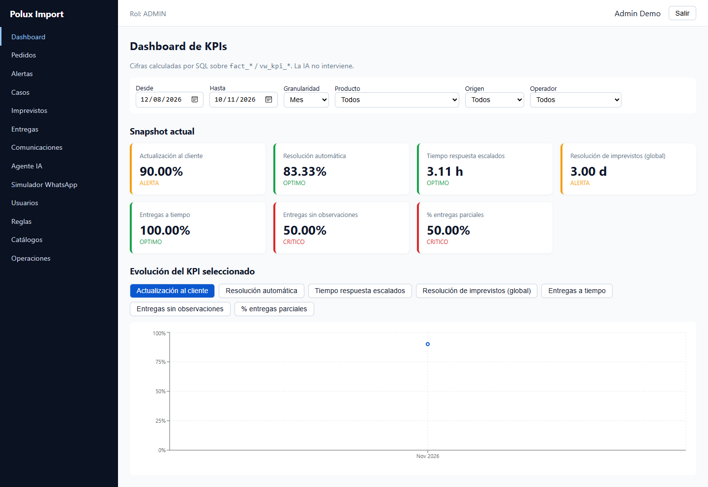

### 2.1 Las tarjetas de indicadores

Cada tarjeta muestra un número y un **semáforo**:

| Color | Significado | ¿Qué hago? |
|---|---|---|
| 🟢 **OPTIMO** | Todo va bien | Nada por ahora |
| 🟡 **ALERTA** | Empieza a desviarse | Mantén vigilancia |
| 🔴 **CRITICO** | Requiere acción | Revisa el área responsable |
| ⚪ Sin valor (`—`) | Aún no hay datos | Aparecerá cuando haya operación |

Las tarjetas muestran, por ejemplo:

- **Actualización al cliente** — qué tan seguido avisamos al cliente
  cuando avanza un hito.
- **Resolución automática** — qué proporción de consultas resolvió el
  sistema sin necesitar a una persona.
- **Tiempo respuesta escalados** — cuánto tarda una persona en
  atender un caso (en horas).
- **Resolución de imprevistos** — cuántos días tardamos en resolver
  incidencias.
- **Entregas a tiempo / sin observaciones / % parciales** — cómo va
  la calidad de las entregas.

> Los indicadores se calculan solos con la información del sistema.
> **Nadie los captura a mano.**

### 2.2 Usar los filtros

Justo debajo del título hay filtros: **Desde / Hasta** (fechas),
**Granularidad** (ver por día, semana o mes), **Producto**, **Origen**
(Stock / Importación) y **Operador**.

1. Cambia cualquier filtro.
2. El gráfico de **"Evolución del KPI seleccionado"** se actualiza.
3. Para ver otro indicador en el gráfico, haz clic en su botón
   (por ejemplo *Entregas a tiempo*).

### 2.3 El gráfico de evolución

Muestra cómo se ha comportado el indicador elegido en el tiempo. Cada
punto es un período (día, semana o mes según la granularidad).

---

## 3. Buscar y revisar un pedido

1. En el menú, haz clic en **Pedidos**:

   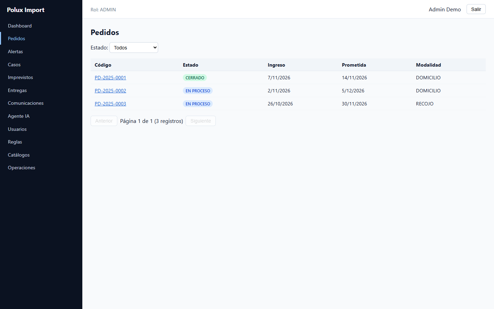

2. Usa el **filtro de estado** (Recibido, En proceso, En coordinación,
   Cerrado…) para acotar la lista.
3. Haz clic en el pedido que te interese. Verás su detalle:

   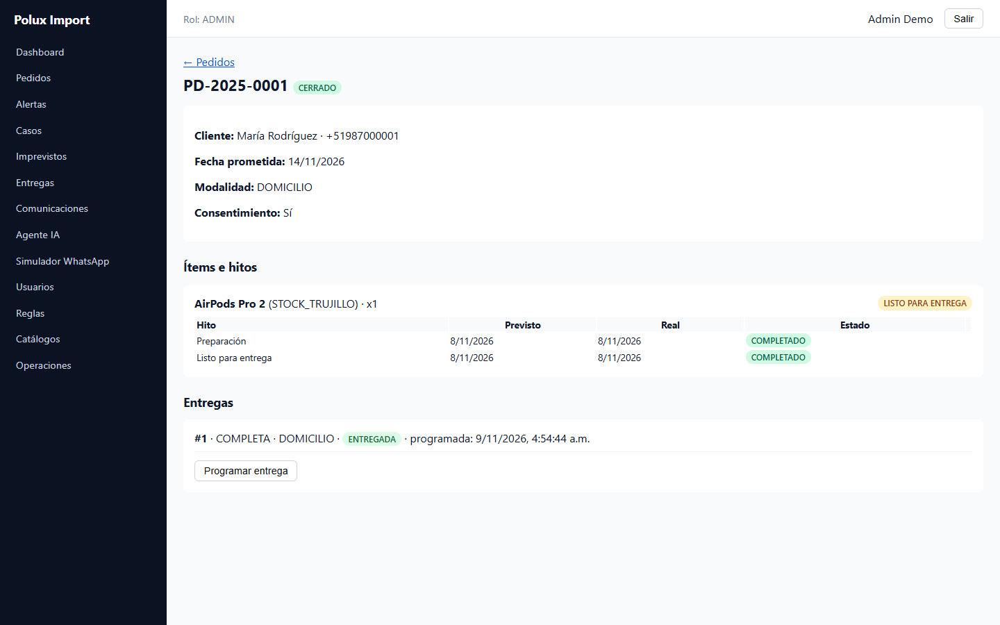

### Qué significa cada cosa del detalle

- **Estado del pedido** (junto al número): dónde está en el proceso.
- **Cliente, fecha prometida, modalidad:** datos clave de la entrega.
- **Ítems e hitos:** cada fila es un paso del proceso (por ejemplo
  *Preparación*, *Listo para entrega*), con su fecha **Prevista** y su
  fecha **Real**.
  - 🟢 **COMPLETADO** — paso terminado.
  - 🔴 **ATRASADO** — el paso se pasó de su fecha prevista.
  - ⚪ **PENDIENTE** — aún no comienza.
- **Entregas:** las entregas hechas para ese pedido (o la nota
  *"Sin entregas registradas"*).
- **Línea de tiempo:** la historia completa del pedido en una sola
  lista, de más reciente a más antigua: cuándo se ingresó, hitos
  completados o atrasados, casos, imprevistos, entregas, alertas y los
  mensajes clave (quejas, respuestas del asesor y avisos automáticos).
  Cada evento trae su fecha y a qué caso o imprevisto pertenece.
  La casilla **Ver todos los mensajes e interacciones**
  agrega también las conversaciones normales del cliente.

---

## 4. Marcar un hito como completado

**¿Cuándo?** Cuando un paso del proceso terminó en la vida real
(p. ej. la preparación terminó).

1. Entra al detalle del pedido (ver tarea anterior).
2. En la fila del hito, haz clic en **Completar**.
3. Confirma con **Confirmar**.

El hito quedará en verde con la fecha de hoy, y el sistema avisará
automáticamente al cliente por el canal configurado.

> ⚠️ Solo marca lo que realmente haya ocurrido: de eso dependen los
> indicadores del panel y los avisos a los clientes.

---

## 5. Revisar las alertas

**¿Para qué?** Las alertas son los avisos automáticos del sistema
(retrasos, imprevistos, silencios del cliente).

1. En el menú, haz clic en **Alertas**:

   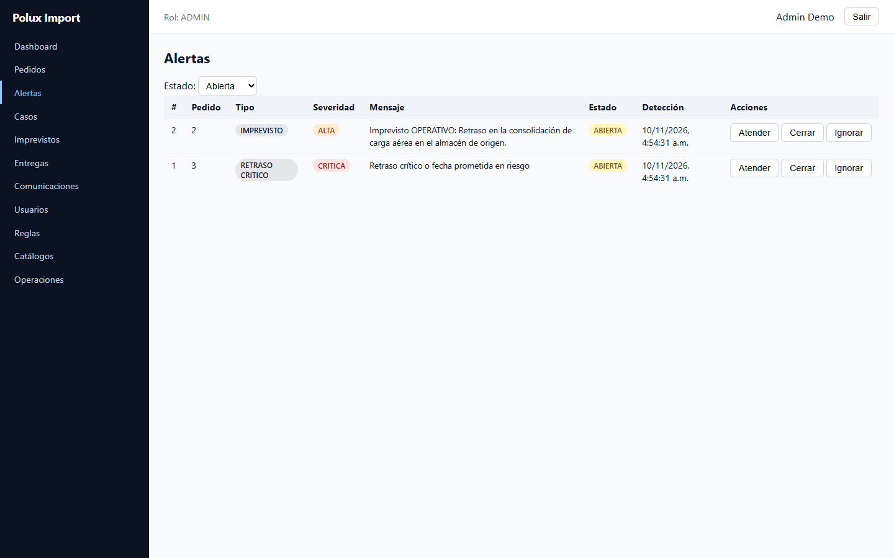

2. Filtra por estado: **Abierta**, **Atendida**, **Cerrada**…
3. Cuando hayas tratado una alerta, haz clic en:
   - **Atender** — ya la estás gestionando.
   - **Cerrar** — el asunto terminó.
   - **Ignorar** — no requiere acción.

> Las alertas **críticas** (por ejemplo un retraso grande) crean
> además un **caso** automáticamente — revisa la tarea siguiente.

---

## 6. Atender un caso de escalamiento

**¿Qué es un caso?** Una situación que necesita a una persona:
reclamos, retrasos graves, etc.

1. En el menú, haz clic en **Casos**:

   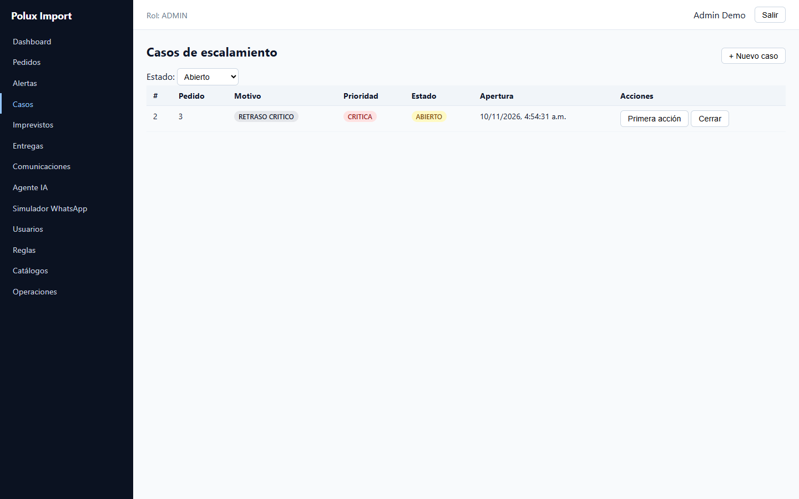

2. Revisa los casos **Abiertos** (filtro superior).
3. Haz clic en **Responder** para ver la conversación con el cliente y
   escribirle sin salir de la plataforma. El **primer operador** que
   responde queda como responsable del caso y los demás ya no podrán
   responderlo (verás el aviso *«Otro operador ya tomó este caso»*).
4. Si el cliente no tiene Telegram vinculado, la plataforma te avisará y
   no enviará nada: pídele que escriba al bot con su **código de pedido +
   DNI** y vuelve a intentarlo.
5. La **primera respuesta** registra automáticamente *cuándo* atendiste
   (esto mide el indicador *Tiempo respuesta escalados*). También puedes
   marcarla manualmente con **Primera acción**: si el caso está libre,
   queda asignado a ti. Si estabas viendo los casos **Abiertos**, el
   mantenedor pasa al filtro **En proceso** para que el caso no
   desaparezca de la lista.
6. Cuando el problema quede resuelto, haz clic en **Cerrar**; el caso
   pasa a cerrado, se avisa al cliente por Telegram si está vinculado y
   el agente vuelve a responder automáticamente los siguientes mensajes.

> 🔒 Los mensajes internos del sistema (comandos, avisos a operadores,
> confirmaciones) no se mezclan con la conversación del cliente. Puedes
> verlos en **Comunicaciones** filtrando por clase **Operativo**.

> 🕐 Lo importante es registrar la **primera acción** rápido: el
> indicador del panel cuenta las horas desde que se abrió el caso.

### Crear un caso manualmente

Si detectas un problema que aún no tiene caso (sin necesidad de que el
sistema lo genere):

1. Haz clic en **+ Nuevo caso** (arriba a la derecha).
2. Elige el **pedido**, el **motivo**, la **prioridad** y escribe qué
   pasó:

   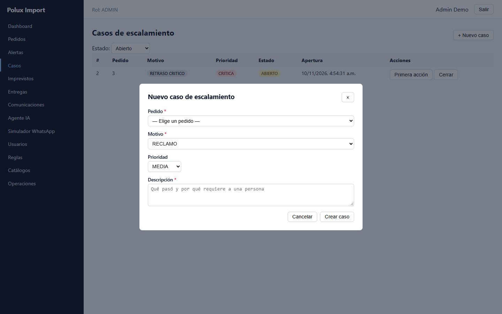

3. Haz clic en **Crear caso**. Aparecerá en la lista con estado
   *Abierto*.

---

## 7. Registrar y resolver un imprevisto

**¿Qué es?** Un problema puntual del viaje: aduana, proveedor,
transporte…

### Registrar uno nuevo (desde el menú *Imprevistos*)

1. Haz clic en **Imprevistos**:

   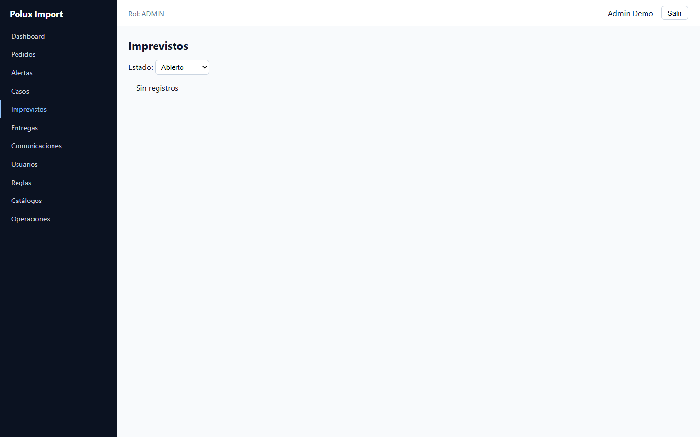

2. El sistema lo lista con su estado: **Abierto**, **En proceso**,
   **Resuelto**.
3. Filtra por estado para ver los pendientes.

> 💡 Si quieres registrar uno nuevo, haz clic en **+ Nuevo imprevisto**
> (arriba a la derecha), elige el pedido, el tipo y escribe qué pasó.

### Resolverlo

1. Cuando la incidencia termine, haz clic en **Resolver** en la fila
   correspondiente.
2. El sistema pedirá el detalle de la resolución — escríbela con
   claridad (fecha, qué pasó, cómo se resolvió).

> El sistema mide solo los días entre detectarlo y resolverlo, y eso
> alimenta el indicador *Resolución de imprevistos*.

---

## 8. Revisar las conversaciones con clientes

1. En el menú, haz clic en **Comunicaciones**:

   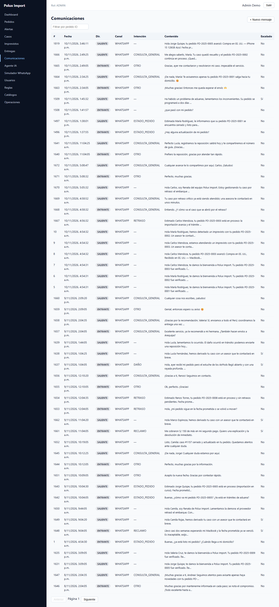

2. Verás cada mensaje: de quién es (cliente o sistema), fecha, canal y
   contenido.
3. Usa **Filtrar por pedido ID** para ver solo la conversación de un
   pedido.
4. Usa **Anterior / Siguiente** para recorrer la lista.

> 💡 Para anotar una conversación hecha por otro medio (llamada,
> correo…), usa **+ Nuevo mensaje**: elige el pedido, la dirección
> (hacia el cliente o del cliente), el canal, quién escribe y el texto.

> También puedes buscar la conversación desde el pedido: el historial
> completo queda registrado por pedido.

---

## 9. Programar y completar una entrega

### 9.1 Programar

1. En el menú, haz clic en **Entregas**:

   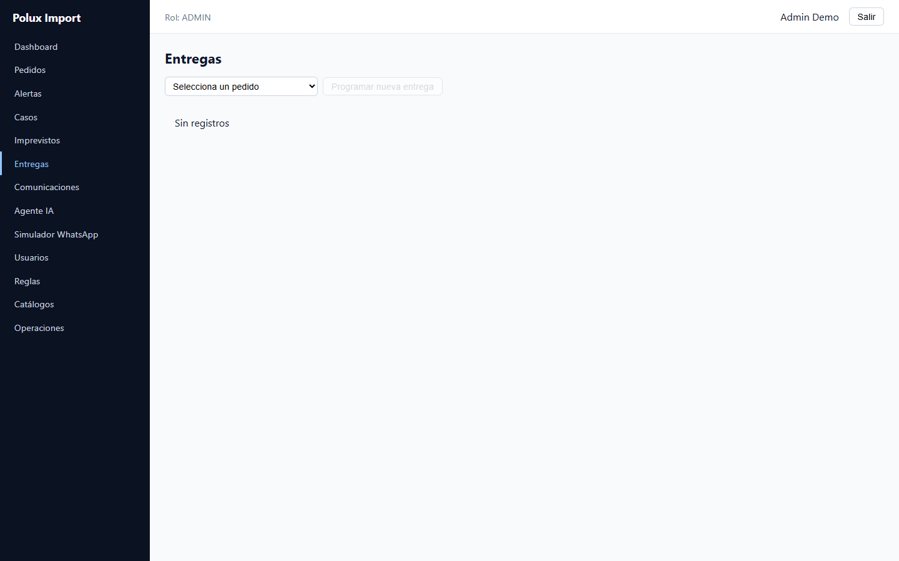

2. Elige el **pedido** en el primer desplegable.
3. Haz clic en **Programar nueva entrega**.
4. Completa: tipo (**Completa** o **Parcial**), modalidad
   (**Domicilio** o **Recojo**) y la fecha.
5. Guarda.

> 🔒 Las **entregas parciales** (entregar solo parte del pedido)
> necesitan autorización: el sistema exige quién autoriza, cuándo y
> por qué. Es una regla que no se puede saltar.

### 9.2 Completar (con checklist)

1. En la fila de la entrega, haz clic en **Completar**.
2. Marca el checklist de cada ítem (caja sellada, modelo, color,
   capacidad, IMEI, accesorios).
3. Elige el resultado:
   - **Conforme** — todo bien.
   - **Con observaciones** — hubo un detalle; descríbelo.
4. Confirma. El sistema:
   - actualiza el estado del pedido,
   - guarda las evidencias,
   - envía la confirmación al cliente,
   - y refleja el resultado en los indicadores.

---

## 10. Administración (solo Admin)

### 10.1 Usuarios

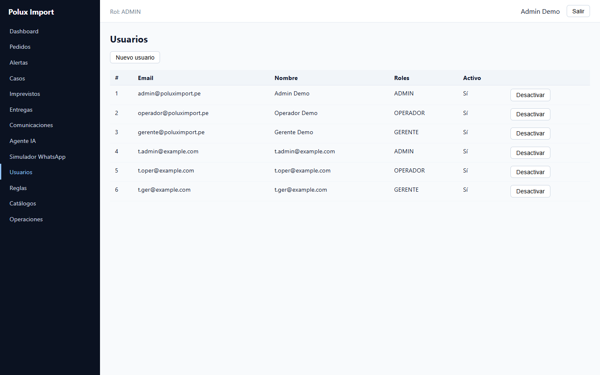

- **Crear:** llena nombre, correo, contraseña y marca el rol
  (Admin, Operador o Gerente) → **Crear**.
- Para cambiar algo de un usuario, edita sus datos y guarda.

### 10.2 Reglas de negocio

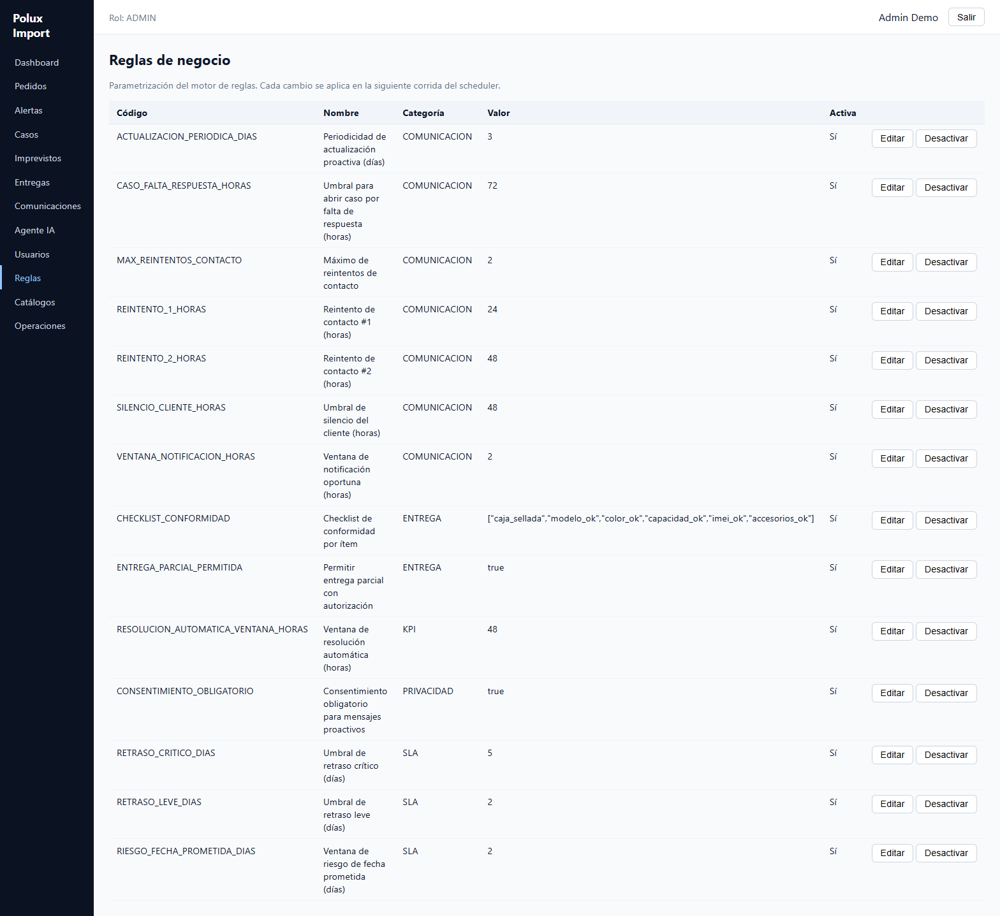

Aquí se ajustan los **umbrales** que usan las reglas automáticas
(p. ej. cuántos días de tolerancia antes de alertar).

1. Haz clic en **Editar** en la regla.
2. Escribe el nuevo valor.
3. Guarda. El cambio aplica de inmediato — sin reiniciar nada.

### 10.3 Catálogos (hitos, SLAs, plantillas e indicadores)

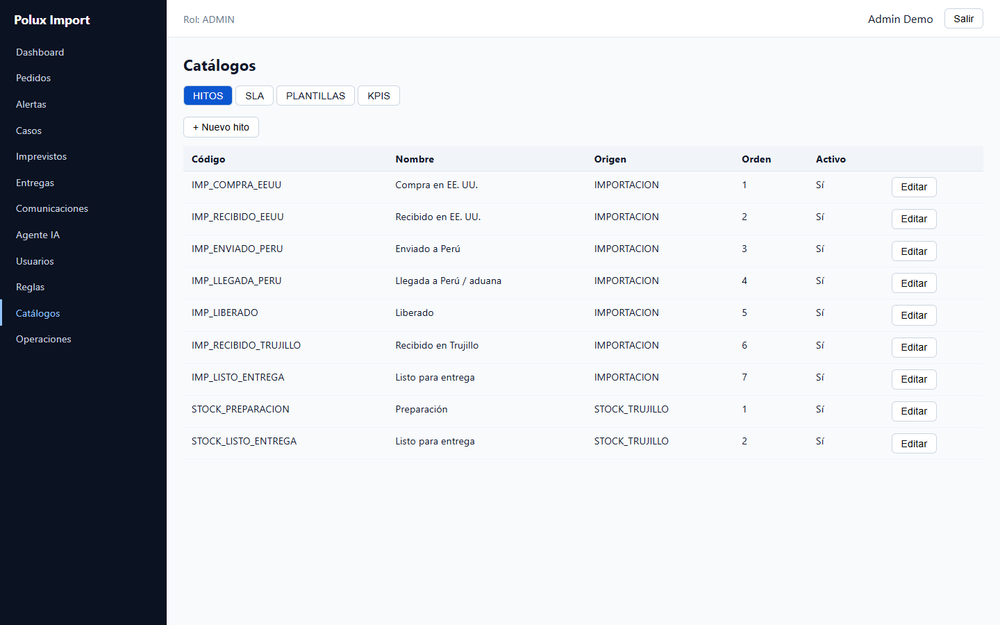

- **Hitos:** pasos que siguen los pedidos (crear/editar).
- **SLA:** cuántos días puede durar cada hito.
- **Plantillas:** textos de los mensajes que recibe el cliente
  (puedes personalizarlos).
- **Umbrales de indicadores:** cambia los valores verde/ámbar/rojo de
  cada tarjeta del panel. Por ejemplo, si para *Entregas a tiempo*
  consideras "bien" a partir de 95%, cambia el umbral y el semáforo
  se recalculará solo.

### 10.4 Operaciones

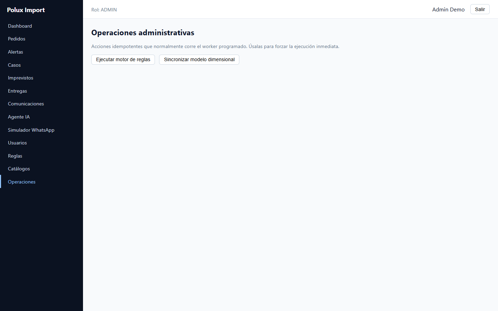

Botones para forzar tareas que normalmente corren solas cada pocos
minutos:

- **Ejecutar motor de reglas** — genera ahora los avisos, alertas y
  casos que correspondan.
- **Sincronizar modelo dimensional** — actualiza ya los indicadores
  del panel.

> Úsalos si acabes de cargar datos y quieres ver el panel al día sin
> esperar.

---

## 11. Puede ver cada rol

| Sección | Admin | Operador | Gerente |
|---|:---:|:---:|:---:|
| Dashboard (indicadores) | ✅ | ✅ | ✅ |
| Pedidos, hitos, entregas | ✅ | ✅ | ❌ |
| Alertas, casos, imprevistos, comunicaciones | ✅ | ✅ | ❌ |
| Agente IA (probar el asistente) | ✅ | ✅ | ❌ |
| Contestador (chats asignados) | ✅ | ✅ | ❌ |
| Responder casos desde la plataforma | ✅ | ✅ | ❌ |
| Usuarios, reglas, catálogos, operaciones | ✅ | ❌ | ❌ |

El menú muestra solo las opciones a las que tienes acceso. Si necesitas
que te amplíen permisos, pídeselo a un Administrador.

---

## 12. Hablar con el agente IA

**¿Qué es?** Un asistente automático que recibe las consultas de los
clientes (como si llegaran por WhatsApp), las entiende, responde con
mensajes aprobados y decide cuándo pasarle el caso a una persona.

Disponible para **Administradores** y **Operadores** (menú
**Agente IA**):

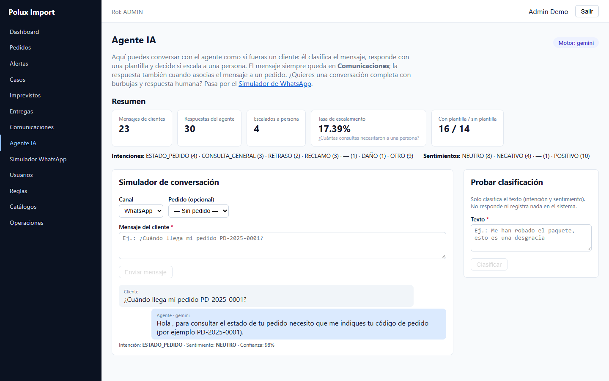

### 12.1 Probar una conversación

1. En el menú, haz clic en **Agente IA**.
2. En **Probar conversación** puedes elegir el canal (WhatsApp, Email,
   Web o Telegram) y, si quieres, asociar un pedido.
3. Escribe un mensaje como si fueras el cliente — por ejemplo
   *«¿Cuándo llega mi pedido?»* — y haz clic en **Enviar mensaje**.
4. Verás la respuesta del agente y, debajo, cómo lo interpretó:
   **intención** (qué quería el cliente), **sentimiento** (cómo estaba)
   y **confianza** (qué tan seguro estaba).

Si el asunto es grave (un reclamo, por ejemplo), el agente lo marca
como **escalado** y crea un **caso** para que lo atienda una persona.

> 💡 ¿Quieres responder a un cliente real? Pasa a la sección
> [13 · Responder casos desde la plataforma](#13-responder-casos-desde-la-plataforma).

### 12.2 Ver el resumen

Las tarjetas de arriba muestran, en tiempo real:

- cuántos mensajes de clientes ha recibido,
- cuántas respuestas ha enviado,
- cuántos tuvo que escalar a una persona (y el porcentaje),
- cuántas respuestas fueron con mensajes aprobados.

### 12.3 Probar solo la clasificación (solo Admin)

El recuadro **Probar clasificación** analiza un texto y muestra qué
intención y sentimiento detecta — **sin** responder ni registrar nada
en el sistema. Sirve para comprobar cómo reaccionaría.

> 📌 Todo lo que pruebes con un pedido asociado queda registrado en
> **Comunicaciones**, como cualquier otra conversación.

---

## 13. Responder casos desde la plataforma

**¿Qué es?** La forma de atender a un cliente sin usar tu Telegram
personal: desde **Contestador** o **Casos → Responder** ves la
conversación, escribes la respuesta y el sistema la entrega por el canal
configurado (Telegram). Es el mismo flujo que responder desde el bot, con
la misma asignación y auditoría.

Disponible para **Administradores** y **Operadores**:

### 13.1 Contestador: tus conversaciones asignadas

El menú **Contestador** es la bandeja de trabajo diaria:

- **Operador:** solo ve los chats de casos **asignados a él**. Si no tiene
  ninguno, entra a **Casos**, abre un caso **sin asignar** y responde:
  al enviar, el caso queda para él.
- **Administrador:** ve todas las conversaciones y puede responder incluso
  las asignadas a un operador; la asignación se mantiene.
- La lista muestra cliente, código de pedido, último mensaje, caso abierto
  y responsable. El botón **Historial** abre la línea de tiempo del pedido.

### 13.2 Abrir y responder un caso

1. En el menú, haz clic en **Casos** y localiza el caso **Abierto**.
2. Pulsa **Responder**. Se abre la ficha con:
   - el pedido y el nombre del cliente;
   - el **responsable** actual (o *sin asignar*);
   - si el cliente tiene **Telegram vinculado**;
   - el hilo de la conversación (solo mensajes del cliente y respuestas).
3. Escribe en **Respuesta al cliente** y pulsa **Enviar respuesta**.
4. El **primer operador** que responde queda como responsable y el caso
   pasa a **En proceso**. Si otro operador intenta responder después,
   verá *«Otro operador ya tomó este caso»* y no podrá enviar.
   **Primera acción** también reclama el caso libre para quien la pulsa.
5. Usa **Ver la línea de tiempo del pedido** dentro de la misma ventana
   para revisar hitos, casos, imprevistos, entregas y alertas.

### 13.3 Si el cliente no tiene Telegram

La ficha mostrará **Telegram del cliente: sin vincular ⚠️** y el botón
de envío quedará deshabilitado. Para vincularlo, el cliente debe escribir
al bot con su **código de pedido + DNI** (por ejemplo
`PD-2025-0005 70000004`). Mientras no lo haga, la plataforma no puede
entregar la respuesta; el intento queda registrado como **Operativo**
para auditoría, pero el caso **no** se asigna.

### 13.4 Cerrar el caso

Cuando el problema esté resuelto, pulsa **Cerrar** en la fila del caso.
El caso pasa a **Cerrado** y, si el cliente tiene Telegram, recibe el
aviso de cierre. Todo queda en la línea de tiempo y en
**Comunicaciones**. Al cerrar el caso, el **agente retoma la conversación**
de inmediato: los siguientes mensajes del cliente vuelven a responderse
automáticamente, sin esperar los 10 minutos de la pausa humana.

### 13.5 Liberar o reasignar un caso

- **Operador:** en **Casos**, los casos que tiene asignados muestran el
  botón **Liberar**. Al pulsarlo, el caso queda **sin asignar** para que
  otro operador lo tome; se conserva todo el historial.
- **Administrador:** en la ficha del caso puede elegir el **responsable**
  en el selector de asignación y pulsar **Guardar asignación**. También
  puede dejar el caso **sin asignar**.
- Cada liberación o reasignación queda registrada como mensaje
  **Operativo** y, si el nuevo responsable tiene Telegram vinculado, le
  llega un aviso.

---

## 14. Preguntas frecuentes

**No puedo entrar — dice "Credenciales inválidas".**
Revisa el correo y la contraseña (mayúsculas minúsculas). Si sigue
fallando, contacta al Administrador para que te restablezca la
contraseña.

**El panel muestra todo en gris o con guiones (`—`).**
Significa que todavía no hay operación registrada en ese período.
A medida que se registren hitos, entregas y conversaciones, los
valores aparecerán.

**¿Cada cuánto se actualizan los indicadores?**
Automáticamente cada pocos minutos. Si necesitas verlos al instante
después de un cambio, ve a **Operaciones** → **Sincronizar modelo
dimensional** (Admin).

**El cliente no recibió un aviso.**
Revisa la sección **Comunicaciones**: si el mensaje aparece como
pendiente o fallido, vuelve a **Operaciones** → **Ejecutar motor de
reglas** y luego consulta de nuevo.

**¿Quién puede autorizar una entrega parcial?**
Solo un Administrador; el sistema guarda quién autorizó, cuándo y por
qué.

**No encuentro un pedido.**
En **Pedidos**, prueba con el filtro de estado (p. ej. *En proceso*)
y revisa la lista completa con scroll.

---

**Anterior:** [`04-agente.md`](04-agente.md) ·
**Siguiente:** [`06-api.md`](06-api.md)
